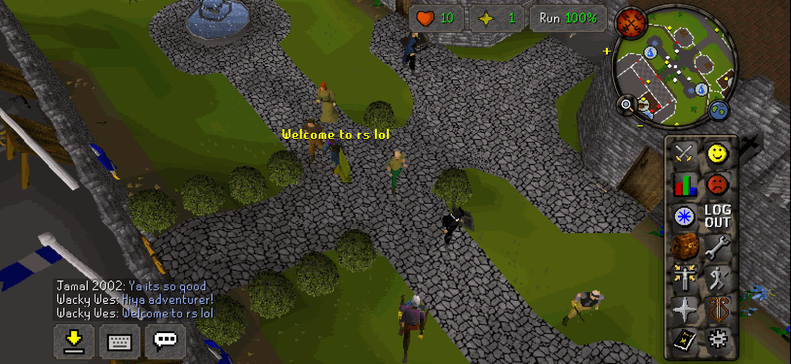
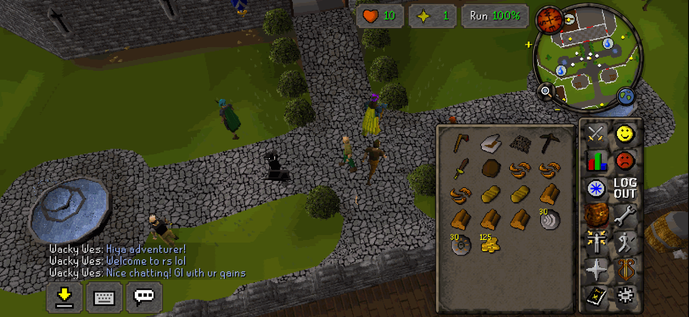
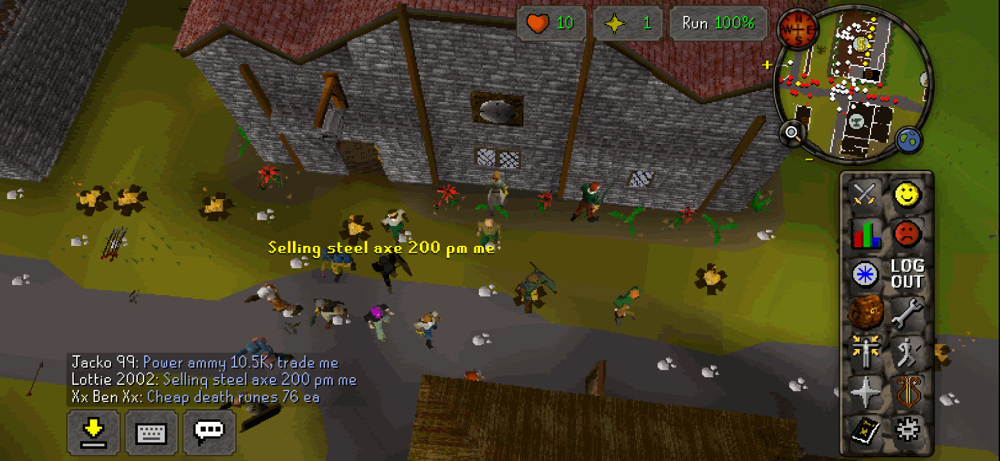
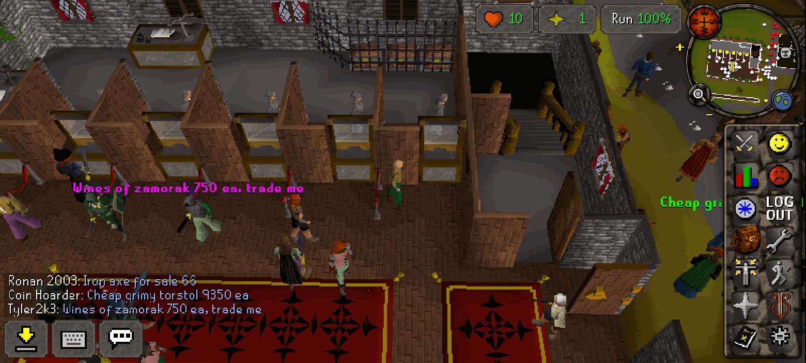
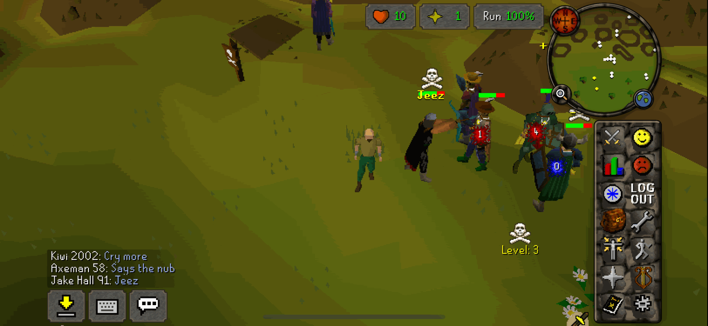

# 2004Scape: Single Player Mobile Port

**RuneScape as it was in 2004, offline on your phone.** 2004Scape is an iPhone and Android app that runs
[Lost City](https://lostcity.rs), the open-source recreation of RuneScape revision 274 (late 2004), entirely on the
device: the game server and the original web client both run inside the app, with a touch interface in the 2004 look.
There is no account, no server and no internet connection involved. You can play alone, or let up to 1,000 AI players
fill the world: they train their skills, bank, trade, chat, fight in the Wilderness, and come and go the way players
did in 2004. Their replies to you can be written by a small chat model that runs on the phone, which is optional.

> **Built on other people's work, with AI.** 2004Scape is a derived work, not an original game. The game is
> [Lost City](https://github.com/LostCityRS)'s: its server (Engine-TS), web client (Client-TS) and game content (Content)
> run inside the app, with this project's patches for touch and offline play. The bots are a port of the bot AI of
> [2004sp-progressive](https://github.com/2004sp/2004sp-progressive). What this project adds is the iPhone and Android
> apps, the offline packaging, the touch interface and the bots' extensions. Most of that code, its tests and this
> documentation were generated by Claude (Anthropic's AI model, through Claude Code). See [Credits](#credits).

> **Get it on your phone:** [Android guide](docs/INSTALL-ANDROID.md) (about 10 minutes, no computer) ·
> [iPhone guide](docs/INSTALL-IPHONE.md) (about 30 minutes, needs a Mac or Windows PC) ·
> [Download page](https://github.com/PureXYZ/2004scape-sp-mobile/releases/latest)

> 2004Scape is an unofficial fan project. It is not affiliated with, endorsed by or connected to Jagex Ltd or the Lost City project. RuneScape is a registered trademark of Jagex Ltd. The game data the app is built from is the intellectual property of Jagex Ltd. This project is free: no ads, no payments, no accounts.

| | |
|---|---|
|  |  |
|  |  |

- [Install on Android](#install-on-android)
- [Install on iPhone](#install-on-iphone)
- [Playing](#playing)
- [FAQ](#faq)
- [Build from source](#build-from-source), [how it works](#how-it-works), [credits](#credits), [licence](#licence)

## Install on Android

**Android 11 or later**, on a 64-bit phone. There is no Play Store listing: you download the app from the
[download page](https://github.com/PureXYZ/2004scape-sp-mobile/releases/latest) on the phone and open it
("sideloading": installing an app from outside the store). Pick one file:

- `2004Scape-<version>-android.apk`: the full app, about 580 MB, with the on-device chat model for the bots.
- `2004Scape-<version>-android-lite.apk`: about 54 MB, the same app without the chat model. Everything works, bots
  included; they reply with their own ready-made lines.

Android asks you to allow **Install unknown apps** for your browser, and Google Play Protect (or Samsung's Auto
Blocker) may warn you first. To update, install the newer APK over the old one: your saves are kept.

**Step by step, with every warning explained: [docs/INSTALL-ANDROID.md](docs/INSTALL-ANDROID.md)** (also: updating
with Obtainium, backups, troubleshooting, checking the signing certificate, Google's 2027 changes).

## Install on iPhone

**iOS 18.4 or later**, and a Mac or Windows PC (with Sideloadly, also for the refresh every 7 days; SideStore needs it
only for setup). Apple only runs apps from outside the App Store ("sideloading") when they are signed with an Apple
Account (formerly Apple ID), so a free sideloading tool signs the app with your own free Apple Account. Download one IPA
from the [download page](https://github.com/PureXYZ/2004scape-sp-mobile/releases/latest):

- `2004Scape-<version>-ios.ipa`: the full app, about 550 MB, with the on-device chat model.
- `2004Scape-<version>-ios-lite.ipa`: about 40 MB, the same app without the chat model.

With a free Apple Account the app stops opening after **7 days** until you refresh it with the same tool and Apple
Account, which keeps your saves, and you can have at most 3 sideloaded apps at a time.

**Step by step with [Sideloadly](https://sideloadly.io), plus [AltStore](https://altstore.io) and
[SideStore](https://sidestore.io), Apple Account safety and troubleshooting: [docs/INSTALL-IPHONE.md](docs/INSTALL-IPHONE.md).**
Or build it yourself with Xcode: [docs/BUILDING.md](docs/BUILDING.md).

## Playing

Tap **New User** or **Existing User** on the title screen and type any name: offline there is no password, and a new
name makes a new character on Tutorial Island. Next time, **Continue as <name>** brings your last character back with
one tap; **Characters** lists the others.

**Controls.** The world fills the screen; the minimap and the hitpoints, prayer and run orbs are at the top right, the
13 classic tabs and ⚙ Settings down the right, the chat at the bottom left with its buttons (tap-to-drop, keyboard,
chatbox).

| Gesture | What it does |
|---|---|
| Tap | Left click: walk, talk, attack, take, use. What the tap did shows beside it for a moment |
| Hold | The options menu (right click), in large rows beside your finger: slide onto an option and let go, or lift and tap it |
| Drag on the world | Turn and tilt the camera |
| Pinch | Zoom the camera |
| Drag on a list, the bank or the chat | Scroll it |
| Drag an item | Move it |

Developer commands work in chat while Settings › World › Jmod is On, for example `::tele 0,50,50,22,18` (Lumbridge).

### Your saves

Your characters are saved on the phone as you play, and when the app goes to the background.

- **iPhone:** in the Files app under On My iPhone › 2004Scape: `players/` holds your characters and `bots/` the bots'
  world. Copy those folders somewhere else to back them up, and copy them back to restore. **Deleting the app deletes
  them**, so copy them out first.
- **Android:** Android's own file browser shows **2004Scape** in its ☰ side menu, with the same `players/` and `bots/`
  folders (the Files app on Pixel and many phones; on Samsung, Google Drive's + › Upload opens it, see
  [backups](docs/INSTALL-ANDROID.md#backing-up-your-saves)). Android's own backup (Google) keeps them too. When you uninstall, Android offers to keep the app's data:
  tick it if you plan to reinstall.

Every save keeps the previous version beside it as `.bak` (for example `players/main/zezima.sav.bak`): with the game
closed, delete `zezima.sav` and rename the `.bak` back to restore it.
Settings › Saved data can delete a character, reset the bots' world or delete everything.

### Settings

Settings opens from the ⚙ button. The defaults:

| Category | Setting | Default |
|---|---|---|
| Display | Layout: Mobile (full-screen world) or Classic (the original 765×503 screen) | Mobile |
| | Frame rate 30 / 50, World scaling Smooth / Pixel, Camera buttons | 50, Pixel, Hide |
| | Screen margins (**Adjust**): Side, Top and Bottom, each None / Auto / +16 / +32 (space kept clear of the screen's edges, notch or camera hole) | Auto |
| Sound | Silent switch: Mute / Play (iPhone; Android always plays), Vibration | Play, On |
| Controls | Hold for menu, Camera drag, Options menu Large / Classic | Normal (400 ms), Normal, Large |
| Tap options | What a tap does with Attack on NPCs and on players: Tap, By level, Hold or Hidden | By level (as in 2004) |
| World | World type Members / Free | Members |
| | XP rate 1×, 2×, 5×, 10×, 25×, 50× | 10× |
| | Jmod (staff commands and the crown) | Off |
| | Bots: Off, 25, 50, 100, 250, 500, 750, 1000 | 500 |
| | Detail High / Low | High |
| Bot chat | Chat model: Rules, On-device, Claude online; Think first | On-device (Rules without a model), Think first On |

World settings apply when you tap **Restart** in that category. Settings › About shows the version and
the build, the disclaimer, the credits and, under **Licences**, the licences of everything the app is made from
([LICENSE](LICENSE), [THIRD_PARTY_NOTICES.md](THIRD_PARTY_NOTICES.md)).

### Bots

With Settings › World › Bots above Off, other players share your world. About that many are online at a time, out of a
pool twice that size that takes turns: each plays a session of a few minutes to a few hours, logs out and comes back
later as it left. New players arrive at Lumbridge now and then, especially after you make a new character. A new bot
world starts with a mix of newcomers, mid-levels and veterans, and they level at the world's XP rate.

They do what 2004 players did: train skills, buy gear, bank, sell at Varrock West and the other trade banks, hang out
at Falador park, run drop parties and clan walks, duel at the Duel Arena (members worlds), PK at the Edgeville ditch and
deep in the Wilderness (only within the game's PvP rules), get random events, and chat. Talk to one by its name in
public chat ("hi Lumby Larry"), add one as a friend, trade with a vendor, or private-message a friend **come here** and
it runs over. A bot never takes your character's name.

How the bots are built: [docs/BOTS.md](docs/BOTS.md).

### Bot chat

Settings › Bot chat picks who writes a bot's words when it answers you. Whether a bot answers, and what it does, is
always the bots' own logic.

- **Rules:** the bots' scripted lines.
- **On-device** (the default in the full app): a small language model (Qwen3.5 0.8B, fine-tuned on 2004-style chat)
  runs on the phone, offline. A reply takes about a second; if the phone gets hot, the
  bots fall back to their own lines. **Think first** lets the model plan each reply in a short hidden note first,
  which is a little slower. If you install the full app over the lite one, your choice is kept: pick **On-device**
  here yourself.
- **Claude online:** Claude (Anthropic's Claude Haiku) writes the replies, using **your own** Claude API key from
  [platform.claude.com](https://platform.claude.com) (tap **Set key**). The key is stored only on your phone (the iOS
  Keychain or the Android Keystore), never in the game or its saves. While this is chosen, each reply request sends
  Anthropic the bot's situation (its name, levels, place, what it is doing and carrying) and the recent chat near it,
  including your line and your character's name. Nothing is sent with Rules or On-device. If Claude cannot answer, the
  on-device model does.

Trades, adverts, Wilderness talk and "come here" always stay the bots' own lines.

## FAQ

**Does it need the internet?** No. The game, the bots and the on-device model all run on the phone. Only Claude online
uses the network (and, on iPhone, your sideloading tool when it refreshes the app).

**Why does the iPhone app stop after 7 days?** Apple limits apps signed with a free Apple Account to 7 days. Refresh it with
your sideloading tool (or re-run the build with Xcode); your saves stay.

**I deleted the app. Are my saves gone?** On iPhone, yes: deleting an app deletes its files, so back up `players/`
from the Files app first. On Android, saves survive an uninstall only if you ticked "keep app data", or through
Android's backup.

**Battery and heat?** The game itself is light. Many bots keep the phone busier: on an iPhone 13 mini 500 bots still
run at 50 fps, but expect more battery use and warmth on long sessions at 500 or more (Settings › World says so too).
Lower Settings › World › Bots, then tap **Restart to apply**, if the phone gets warm.

**Can I play online with friends?** No. Each phone runs its own private world, with no server to connect to.

**Is this a private server?** No. Nothing listens on the network: the game server runs inside the app, for you alone.

**Why is the app so big?** The on-device chat model is about 530 MB of the full download. The lite builds leave it out.

**Which devices are supported?** iPhones on iOS 18.4 or later, and Android 11 or later on arm64. It has been tested on
an iPhone 13 mini (iOS 27), the iOS simulator and the Android emulator. iPads are supported too.

## Build from source

Building needs a Mac with Xcode for the iPhone app, and the Android SDK for the Android app; both share one web bundle
built with Node. Everything is in [docs/BUILDING.md](docs/BUILDING.md). Making a release:
[docs/RELEASING.md](docs/RELEASING.md).

## How it works

The Lost City game server (Engine-TS) is bundled to run as a Web Worker, and the Lost City web client (Client-TS) is
built with touch patches; both run in the phone's web view (WKWebView on iOS, Android System WebView on Android) behind
a native shell that serves the game files, keeps the saves and provides the keyboard and haptics. A fake WebSocket
connects the client to the server inside the page. The upstream sources are pinned in [upstream.json](upstream.json) and
used unmodified; this project's changes are the client patches, the engine's browser shims, the bots and the apps.

- [docs/ARCHITECTURE.md](docs/ARCHITECTURE.md): the design and the contracts between the pieces.
- [docs/ANDROID.md](docs/ANDROID.md): what differs on Android.
- [docs/BOTS.md](docs/BOTS.md): the bots.

## Credits

- **[Lost City](https://github.com/LostCityRS)** (Engine-TS, Content, Client-TS) by the Lost City team: the game
  server, the game content and the web client this app runs. Thank you.
- **[2004sp-progressive](https://github.com/2004sp/2004sp-progressive)** by attackishere, _mrsam, K-andy and Callum:
  the bot AI, ported here from revision 254 to 274 and extended.
- **[llama.cpp](https://github.com/ggml-org/llama.cpp)** (ggml.ai and contributors): runs the on-device chat model.
- **[Qwen3.5-0.8B](https://huggingface.co/Qwen/Qwen3.5-0.8B)** by the Qwen team (Alibaba Cloud): the base of the chat
  model.
- **[Claude](https://www.anthropic.com/claude)** (Anthropic), through [Claude Code](https://claude.com/claude-code):
  generated most of this project's code, tests and documentation. Claude also wrote many of the bots' new chat lines and the replies the on-device chat model was trained on.

The full credits and every third-party licence text are in [THIRD_PARTY_NOTICES.md](THIRD_PARTY_NOTICES.md).

## Licence

This project's own code is under the MIT licence: see [LICENSE](LICENSE). The third-party parts keep their own
licences ([THIRD_PARTY_NOTICES.md](THIRD_PARTY_NOTICES.md)). The RuneScape game data the app is built from belongs to
Jagex Ltd and is not covered by any of these licences. Neither are the files in this repository that show Jagex's art:
the app icon (the "RS" rune stones of the 2004 RuneScape logo, in `ios/` and `android/`) and the screenshots in
`docs/images`. They belong to Jagex Ltd, and the MIT licence does not apply to them (THIRD_PARTY_NOTICES.md, section C,
lists them).
